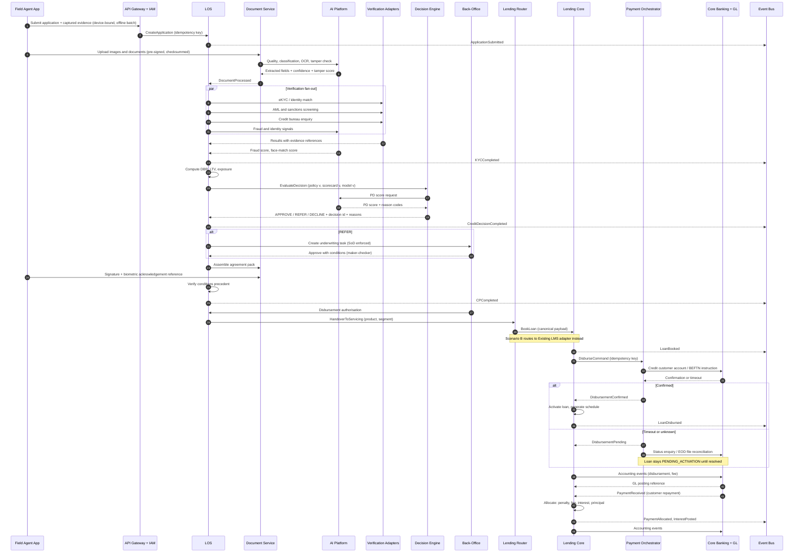

# 02 · End-to-End Lending Journey  &  20 · Sequence Diagram

## 2.1 The 33-step lifecycle with failure branches

```mermaid
flowchart TB

subgraph ACQ["ACQUISITION"]
  S01["01 Partner or customer creates lead"]
  S02["02 Application created in LOS"]
  S03["03 Field agent collects data on site"]
  S04["04 KYC documents and biometrics captured"]
  S05["05 Images and documents processed"]
end

subgraph VER["VERIFICATION"]
  S06{"06 KYC verification"}
  S07{"07 AML and sanctions screening"}
  S08{"08 Credit bureau enquiry"}
  S09{"09 Fraud analysis"}
  S10["10 Income and employment verification"]
end

subgraph RSK["RISK & DECISION"]
  S11["11 DBR, LTV and exposure computed"]
  S12["12 AI risk scoring (signal)"]
  S13["13 Credit policy evaluation"]
  S14["14 Decision engine arbitration"]
  S15{"15 Approve / Refer / Decline"}
  S16["16 Manual underwriting and approval"]
end

subgraph DOC["DOCUMENTATION & BOOKING"]
  S17["17 Offer, agreement and document assembly"]
  S18["18 Customer, witness and officer signature"]
  S19["19 Fingerprint / biometric acknowledgement"]
  S20["20 Conditions precedent satisfied"]
  S21["21 Disbursement authorisation (maker-checker)"]
  S22["22 Loan booked in LMS"]
  S23["23 Core banking posting"]
  S24["24 Loan becomes ACTIVE"]
end

subgraph SRV["SERVICING"]
  S25["25 Repayment schedule runs"]
  S26["26 Payment capture, allocation, posting"]
  S27["27 Interest, fee and penalty accrual"]
  S28["28 DPD and delinquency monitoring"]
end

subgraph REC["COLLECTIONS TO CLOSURE"]
  S29["29 Collections strategy and execution"]
  S30["30 Restructure or recovery"]
  S31["31 Settlement or write-off"]
  S32["32 Loan closure and NOC"]
  S33["33 Regulatory and reporting lifecycle"]
end

F_KYC["KYC failure: re-capture, manual review, or decline"]
F_AML["AML hit: compliance case, block, regulatory report"]
F_BUR["Bureau unavailable: retry, queue, policy fallback or refer"]
F_FRD["Fraud suspicion: fraud case, hold, investigation"]
F_CP["CP not met: return to conditions, expire offer"]
F_POS["Posting timeout: unknown state, reconciliation, ops review"]

S01 --> S02 --> S03 --> S04 --> S05 --> S06
S06 -->|"pass"| S07
S06 -->|"fail"| F_KYC
F_KYC -.->|"re-capture"| S04
S07 -->|"clear"| S08
S07 -->|"hit"| F_AML
S08 -->|"received"| S09
S08 -->|"timeout"| F_BUR
F_BUR -.-> S09
S09 -->|"clear"| S10
S09 -->|"flag"| F_FRD
F_FRD -.->|"cleared"| S10
S10 --> S11 --> S13
S12 -.->|"score signal"| S13
S11 -.->|"features"| S12
S13 --> S14 --> S15
S15 -->|"REFER"| S16
S16 -->|"approved"| S17
S16 -->|"rejected"| F_CP
S15 -->|"APPROVE"| S17
S15 -->|"DECLINE"| F_CP
S17 --> S18 --> S19 --> S20
S20 -->|"incomplete"| F_CP
S20 -->|"complete"| S21 --> S22 ==> S23 ==> S24
S23 -.->|"no response"| F_POS
F_POS -.-> S24
S24 --> S25 --> S26 --> S27 --> S28
S28 -->|"DPD 0"| S25
S28 -->|"DPD > 0"| S29 --> S30 --> S31 --> S32 --> S33
S26 -.-> S33
```

**Reading note.** Solid arrows are the happy path. Dashed arrows are compensating or advisory paths. The `==>` between 22–23–24 is the only money-affecting hop in the origination journey, and it is deliberately the one with an explicit unknown-state branch: a loan is not ACTIVE until the core banking posting is confirmed *or* reconciled.

**Compliance gates are non-compensatory.** Steps 06 and 07 are rhombus gates that no score can override. Step 12 (AI) enters at step 13 as an *input* to policy — it never reaches step 15 directly.

---

## 2.2 Artifact 20 — End-to-end sequence (origination through first payment)

### Why the sequence is shaped this way

- **Verification runs in parallel, decisioning runs once.** Fan-out reduces cycle time; a single decision call keeps the versioned decision record atomic and reproducible.
- **The AI call is inside decisioning, not around it.** `DEC->>AI` means a model timeout degrades to a policy-only decision rather than failing the application.
- **Booking and disbursement are separated.** `BookLoan` creates the account in a non-active state. Money moves afterwards, under its own idempotency key. This is what makes the timeout branch safe.
- **`PENDING_ACTIVATION` is a real state.** It exists so that an unknown payment outcome never produces either a phantom active loan or a silently lost disbursement.
