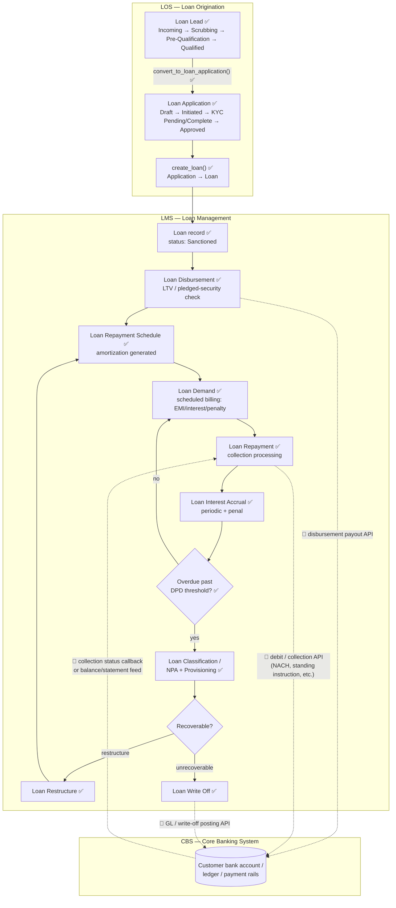

# Flow: LOS → LMS → CBS

> Companion to `planning/LMS_SCOPE.md`. Shows how a loan moves through
> **Loan Origination (LOS)**, **Loan Management / servicing (LMS)**, and
> the **Core Banking System (CBS)** that actually holds the customer's
> bank account and moves money.

**Legend**

| Mark | Meaning |
|---|---|
| ✅ | Confirmed in the installed `lending` app's code (`apps/lending/lending/`) |
| 🧩 | Conceptual integration point — **CBS is not implemented anywhere in this app.** The earlier codebase survey found zero external API integration code (no payment gateway, no bank API). Every CBS touchpoint below is the *assumed* boundary, not a verified contract — treat it as a design placeholder until a real CBS API spec is provided. |

## 1. System responsibilities

| System | Owns | Does not own |
|---|---|---|
| **LOS** (Loan Origination) | Lead capture, KYC/document collection, loan application intake and underwriting decision, sanction | Money movement, servicing after sanction |
| **LMS** (Loan Management, this doc's scope in `LMS_SCOPE.md`) | Disbursement instruction, repayment schedule, billing/demand, collections, collateral, interest accrual, restructuring, write-off, NPA/risk classification, co-lending, statements | The customer's actual bank account/ledger, real payment rails |
| **CBS** (Core Banking System) | The system-of-record bank account, GL/ledger, and payment rails (disbursement payout, repayment debit/collection, balance) | Loan-specific business logic (schedules, demand, classification, restructuring) — LOS/LMS own that |

This split matches one concrete finding from the installed code: `Loan
Product`'s **dual accounting mode** (`enable_loan_accounting` company
flag, see `api.apply_charge`). When it's on, Lending posts its own GL
entries via ERPNext Sales Invoice/Journal Entry — i.e. Lending *is* the
ledger. When it's off, Lending only creates `Loan Demand` records without
GL postings — i.e. something else (a real CBS) is assumed to hold the
ledger. This flow document describes the second case: CBS as the external
system of record.

## 2. High-level flow

## 3. Step-by-step handoff table

| # | Stage | System | What happens | Confirmed? | CBS touchpoint |
|---|---|---|---|---|---|
| 1 | Lead capture & qualification | LOS | `Loan Lead` created, moved through role-gated workflow to Qualified. | ✅ | — |
| 2 | Application intake & underwriting | LOS | Lead converted to `Loan Application`; KYC/document/co-applicant data collected; workflow reaches Approved via Processor/Appraiser/Underwriter roles. | ✅ | — |
| 3 | Sanction | LOS → LMS | `create_loan()` creates the `Loan` record at status Sanctioned. This is the LOS→LMS handoff boundary. | ✅ | — |
| 4 | Disbursement | LMS | `Loan Disbursement` checks LTV against pledged security, then instructs payout. | ✅ (LTV check) | 🧩 Actual fund transfer to the customer's account — LMS has no code to move real money; this must call a CBS payout API. |
| 5 | Schedule generation | LMS | `Loan Repayment Schedule` amortization built from product + disbursed amount. | ✅ | — |
| 6 | Billing / demand | LMS | Scheduled job creates `Loan Demand` lines (EMI, interest, penalty, charges) per due date. | ✅ | — |
| 7 | Collection | LMS | `Loan Repayment` records a payment against demand. | ✅ (recording) | 🧩 The actual debit from the customer's account (auto-debit/NACH/manual transfer) happens in CBS; LMS assumes it already happened or reconciles after the fact — no collection-initiation API exists in this app today. |
| 8 | Interest accrual | LMS | Scheduled accrual (incl. penal interest on overdue amounts). | ✅ | — |
| 9 | Risk classification | LMS | DPD-driven `Loan Classification`/NPA engine, daily scheduled; provisioning computed. | ✅ | — |
| 10 | Restructuring or write-off | LMS | Overdue/unrecoverable loans go through `Loan Restructure` (produces a new schedule, loop back to step 5) or `Loan Write Off`. | ✅ | 🧩 A write-off or restructure typically needs a corresponding GL/ledger adjustment in CBS if CBS holds the books — no such posting exists in this app's code. |
| 11 | Reconciliation / statements | LMS | `Process Loan Statement of Accounts` generates/emails borrower statements; ERPNext bank-reconciliation UI is used for repayment/disbursement matching. | ✅ | 🧩 Reconciliation implies CBS is the source of the actual bank statement/feed being matched against — the feed itself isn't produced by this app. |

## 4. Open questions before CBS integration can be designed for real

These need a real CBS API spec/contract before step 4/7/10's 🧩 items can
move from "assumed" to "confirmed" — flagging per this project's rule
against inventing endpoints/fields that don't exist yet:

- Is disbursement payout synchronous (LMS calls CBS, waits for a
  reference number) or a batch/file-based instruction (e.g. NEFT/RTGS
  batch handed to CBS)?
- Does CBS *push* repayment/collection status to LMS (webhook/callback),
  or does LMS need to *poll* CBS for collection confirmation?
- Who owns the general ledger of record — does `enable_loan_accounting`
  stay off everywhere (CBS owns GL, LMS is demand/servicing-only), or is
  it mixed per product/company?
- Does CBS expose a balance/statement API LMS can call directly for
  reconciliation, or is reconciliation file-based (the ERPNext Bank
  Reconciliation flow the survey found suggests file/statement import,
  not a live API call)?

## 5. Out of scope here

- Detailed LOS internals (already excluded from `LMS_SCOPE.md` by request)
  are only summarized above to show the handoff into LMS.
- Any actual CBS product (Finacle, Temenos, a specific bank's API, etc.)
  is not named or assumed — this doc only marks *where* an integration
  would sit, not *how* one specific CBS would be called.
